# A-SIT und EGIZ: Logos und Farben

Hier liegen die Logo-Dateien von A-SIT und EGIZ zum Herunterladen. Dazu kommen die Farben und die Regeln für den Einsatz.

## Logo herunterladen

| Vorschau | Fassung | Herunterladen |
|---|---|---|
| 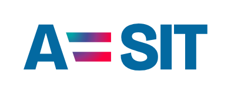 | **Standard**<br>Für weiße und helle Flächen. | [SVG](https://github.com/a-sit/a-sit-ci/raw/main/logo/svg/a-sit-logo.svg)<br>PNG (Höhe in px): [64](https://github.com/a-sit/a-sit-ci/raw/main/logo/png/a-sit-logo-64.png) · [128](https://github.com/a-sit/a-sit-ci/raw/main/logo/png/a-sit-logo-128.png) · [256](https://github.com/a-sit/a-sit-ci/raw/main/logo/png/a-sit-logo-256.png) · [512](https://github.com/a-sit/a-sit-ci/raw/main/logo/png/a-sit-logo-512.png) |
|  | **Dunkel**<br>Für dunkle Flächen. Schrift in hellem Blau. | [SVG](https://github.com/a-sit/a-sit-ci/raw/main/logo/svg/a-sit-logo-dunkel.svg)<br>PNG (Höhe in px): [64](https://github.com/a-sit/a-sit-ci/raw/main/logo/png/a-sit-logo-dunkel-64.png) · [128](https://github.com/a-sit/a-sit-ci/raw/main/logo/png/a-sit-logo-dunkel-128.png) · [256](https://github.com/a-sit/a-sit-ci/raw/main/logo/png/a-sit-logo-dunkel-256.png) · [512](https://github.com/a-sit/a-sit-ci/raw/main/logo/png/a-sit-logo-dunkel-512.png) |
| 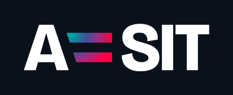 | **Negativ**<br>Für dunkle oder farbige Flächen. Schrift in Weiß. | [SVG](https://github.com/a-sit/a-sit-ci/raw/main/logo/svg/a-sit-logo-negativ.svg)<br>PNG (Höhe in px): [64](https://github.com/a-sit/a-sit-ci/raw/main/logo/png/a-sit-logo-negativ-64.png) · [128](https://github.com/a-sit/a-sit-ci/raw/main/logo/png/a-sit-logo-negativ-128.png) · [256](https://github.com/a-sit/a-sit-ci/raw/main/logo/png/a-sit-logo-negativ-256.png) · [512](https://github.com/a-sit/a-sit-ci/raw/main/logo/png/a-sit-logo-negativ-512.png) |
| 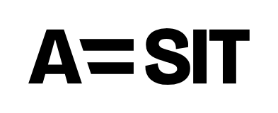 | **Schwarz**<br>Einfarbig, z. B. für Schwarz-Weiß-Druck und Stempel. | [SVG](https://github.com/a-sit/a-sit-ci/raw/main/logo/svg/a-sit-logo-schwarz.svg)<br>PNG (Höhe in px): [64](https://github.com/a-sit/a-sit-ci/raw/main/logo/png/a-sit-logo-schwarz-64.png) · [128](https://github.com/a-sit/a-sit-ci/raw/main/logo/png/a-sit-logo-schwarz-128.png) · [256](https://github.com/a-sit/a-sit-ci/raw/main/logo/png/a-sit-logo-schwarz-256.png) · [512](https://github.com/a-sit/a-sit-ci/raw/main/logo/png/a-sit-logo-schwarz-512.png) |
| 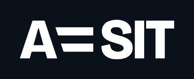 | **Weiß**<br>Einfarbig weiß, z. B. auf Fotos oder für Prägung. | [SVG](https://github.com/a-sit/a-sit-ci/raw/main/logo/svg/a-sit-logo-weiss.svg)<br>PNG (Höhe in px): [64](https://github.com/a-sit/a-sit-ci/raw/main/logo/png/a-sit-logo-weiss-64.png) · [128](https://github.com/a-sit/a-sit-ci/raw/main/logo/png/a-sit-logo-weiss-128.png) · [256](https://github.com/a-sit/a-sit-ci/raw/main/logo/png/a-sit-logo-weiss-256.png) · [512](https://github.com/a-sit/a-sit-ci/raw/main/logo/png/a-sit-logo-weiss-512.png) |

### Symbol

Für kleine Flächen, auf denen die Wortmarke nicht lesbar ist: Browser-Tab (Favicon), App-Symbol, Profilbild.

| Vorschau | Fassung | Herunterladen |
|---|---|---|
| 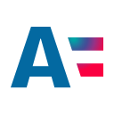 | **Symbol**<br>Das „A“ und der Anfang der Flagge auf einer weißen Kachel. | [SVG](https://github.com/a-sit/a-sit-ci/raw/main/logo/symbol/a-sit-symbol.svg)<br>PNG (px): [64](https://github.com/a-sit/a-sit-ci/raw/main/logo/symbol/a-sit-symbol-64.png) · [128](https://github.com/a-sit/a-sit-ci/raw/main/logo/symbol/a-sit-symbol-128.png) · [256](https://github.com/a-sit/a-sit-ci/raw/main/logo/symbol/a-sit-symbol-256.png) · [512](https://github.com/a-sit/a-sit-ci/raw/main/logo/symbol/a-sit-symbol-512.png) |

Alle PNG-Dateien haben einen transparenten Hintergrund. Verwende nach Möglichkeit SVG. Es bleibt in jeder Größe scharf.

Alle Dateien auf einmal: [ZIP herunterladen](https://github.com/a-sit/a-sit-ci/archive/refs/heads/main.zip).

## EGIZ-Logo herunterladen

Das EGIZ (E-Government Innovationszentrum) ist ein Teil von A-SIT. Sein Logo gehört zur selben Familie: gleiche Schrift, gleiches Blau, gleicher Verlauf.

| Vorschau | Fassung | Herunterladen |
|---|---|---|
| 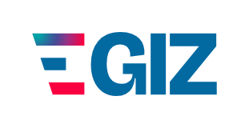 | **Standard**<br>Für weiße und helle Flächen. | [SVG](https://github.com/a-sit/a-sit-ci/raw/main/egiz/svg/egiz-logo.svg)<br>PNG (Höhe in px): [64](https://github.com/a-sit/a-sit-ci/raw/main/egiz/png/egiz-logo-64.png) · [128](https://github.com/a-sit/a-sit-ci/raw/main/egiz/png/egiz-logo-128.png) · [256](https://github.com/a-sit/a-sit-ci/raw/main/egiz/png/egiz-logo-256.png) · [512](https://github.com/a-sit/a-sit-ci/raw/main/egiz/png/egiz-logo-512.png) |
| 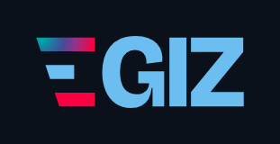 | **Dunkel**<br>Für dunkle Flächen. Schrift in hellem Blau. | [SVG](https://github.com/a-sit/a-sit-ci/raw/main/egiz/svg/egiz-logo-dunkel.svg)<br>PNG (Höhe in px): [64](https://github.com/a-sit/a-sit-ci/raw/main/egiz/png/egiz-logo-dunkel-64.png) · [128](https://github.com/a-sit/a-sit-ci/raw/main/egiz/png/egiz-logo-dunkel-128.png) · [256](https://github.com/a-sit/a-sit-ci/raw/main/egiz/png/egiz-logo-dunkel-256.png) · [512](https://github.com/a-sit/a-sit-ci/raw/main/egiz/png/egiz-logo-dunkel-512.png) |
| 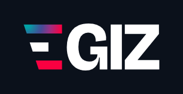 | **Negativ**<br>Für dunkle oder farbige Flächen. Schrift in Weiß. | [SVG](https://github.com/a-sit/a-sit-ci/raw/main/egiz/svg/egiz-logo-negativ.svg)<br>PNG (Höhe in px): [64](https://github.com/a-sit/a-sit-ci/raw/main/egiz/png/egiz-logo-negativ-64.png) · [128](https://github.com/a-sit/a-sit-ci/raw/main/egiz/png/egiz-logo-negativ-128.png) · [256](https://github.com/a-sit/a-sit-ci/raw/main/egiz/png/egiz-logo-negativ-256.png) · [512](https://github.com/a-sit/a-sit-ci/raw/main/egiz/png/egiz-logo-negativ-512.png) |
| 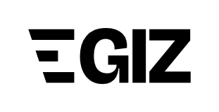 | **Schwarz**<br>Einfarbig, z. B. für Schwarz-Weiß-Druck und Stempel. | [SVG](https://github.com/a-sit/a-sit-ci/raw/main/egiz/svg/egiz-logo-schwarz.svg)<br>PNG (Höhe in px): [64](https://github.com/a-sit/a-sit-ci/raw/main/egiz/png/egiz-logo-schwarz-64.png) · [128](https://github.com/a-sit/a-sit-ci/raw/main/egiz/png/egiz-logo-schwarz-128.png) · [256](https://github.com/a-sit/a-sit-ci/raw/main/egiz/png/egiz-logo-schwarz-256.png) · [512](https://github.com/a-sit/a-sit-ci/raw/main/egiz/png/egiz-logo-schwarz-512.png) |
| 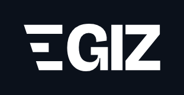 | **Weiß**<br>Einfarbig weiß, z. B. auf Fotos oder für Prägung. | [SVG](https://github.com/a-sit/a-sit-ci/raw/main/egiz/svg/egiz-logo-weiss.svg)<br>PNG (Höhe in px): [64](https://github.com/a-sit/a-sit-ci/raw/main/egiz/png/egiz-logo-weiss-64.png) · [128](https://github.com/a-sit/a-sit-ci/raw/main/egiz/png/egiz-logo-weiss-128.png) · [256](https://github.com/a-sit/a-sit-ci/raw/main/egiz/png/egiz-logo-weiss-256.png) · [512](https://github.com/a-sit/a-sit-ci/raw/main/egiz/png/egiz-logo-weiss-512.png) |

### Mit Unterzeile

Mit dem ausgeschriebenen Namen. Für große Darstellungen, zum Beispiel auf Berichten und Folien. Unter 40 px Höhe das Logo ohne Unterzeile verwenden.

| Vorschau | Fassung | Herunterladen |
|---|---|---|
| 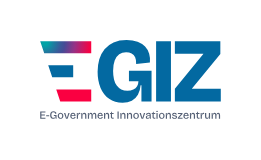 | **Standard**<br>Für weiße und helle Flächen. | [SVG](https://github.com/a-sit/a-sit-ci/raw/main/egiz/svg/egiz-logo-unterzeile.svg)<br>PNG (Höhe in px): [64](https://github.com/a-sit/a-sit-ci/raw/main/egiz/png/egiz-logo-unterzeile-64.png) · [128](https://github.com/a-sit/a-sit-ci/raw/main/egiz/png/egiz-logo-unterzeile-128.png) · [256](https://github.com/a-sit/a-sit-ci/raw/main/egiz/png/egiz-logo-unterzeile-256.png) · [512](https://github.com/a-sit/a-sit-ci/raw/main/egiz/png/egiz-logo-unterzeile-512.png) |
| 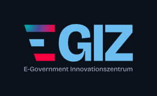 | **Dunkel**<br>Für dunkle Flächen. Schrift in hellem Blau. | [SVG](https://github.com/a-sit/a-sit-ci/raw/main/egiz/svg/egiz-logo-unterzeile-dunkel.svg)<br>PNG (Höhe in px): [64](https://github.com/a-sit/a-sit-ci/raw/main/egiz/png/egiz-logo-unterzeile-dunkel-64.png) · [128](https://github.com/a-sit/a-sit-ci/raw/main/egiz/png/egiz-logo-unterzeile-dunkel-128.png) · [256](https://github.com/a-sit/a-sit-ci/raw/main/egiz/png/egiz-logo-unterzeile-dunkel-256.png) · [512](https://github.com/a-sit/a-sit-ci/raw/main/egiz/png/egiz-logo-unterzeile-dunkel-512.png) |
| 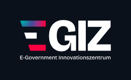 | **Negativ**<br>Für dunkle oder farbige Flächen. Schrift in Weiß. | [SVG](https://github.com/a-sit/a-sit-ci/raw/main/egiz/svg/egiz-logo-unterzeile-negativ.svg)<br>PNG (Höhe in px): [64](https://github.com/a-sit/a-sit-ci/raw/main/egiz/png/egiz-logo-unterzeile-negativ-64.png) · [128](https://github.com/a-sit/a-sit-ci/raw/main/egiz/png/egiz-logo-unterzeile-negativ-128.png) · [256](https://github.com/a-sit/a-sit-ci/raw/main/egiz/png/egiz-logo-unterzeile-negativ-256.png) · [512](https://github.com/a-sit/a-sit-ci/raw/main/egiz/png/egiz-logo-unterzeile-negativ-512.png) |
| 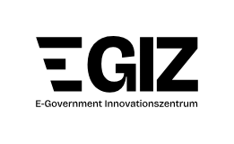 | **Schwarz**<br>Einfarbig, z. B. für Schwarz-Weiß-Druck und Stempel. | [SVG](https://github.com/a-sit/a-sit-ci/raw/main/egiz/svg/egiz-logo-unterzeile-schwarz.svg)<br>PNG (Höhe in px): [64](https://github.com/a-sit/a-sit-ci/raw/main/egiz/png/egiz-logo-unterzeile-schwarz-64.png) · [128](https://github.com/a-sit/a-sit-ci/raw/main/egiz/png/egiz-logo-unterzeile-schwarz-128.png) · [256](https://github.com/a-sit/a-sit-ci/raw/main/egiz/png/egiz-logo-unterzeile-schwarz-256.png) · [512](https://github.com/a-sit/a-sit-ci/raw/main/egiz/png/egiz-logo-unterzeile-schwarz-512.png) |
| 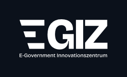 | **Weiß**<br>Einfarbig weiß, z. B. auf Fotos oder für Prägung. | [SVG](https://github.com/a-sit/a-sit-ci/raw/main/egiz/svg/egiz-logo-unterzeile-weiss.svg)<br>PNG (Höhe in px): [64](https://github.com/a-sit/a-sit-ci/raw/main/egiz/png/egiz-logo-unterzeile-weiss-64.png) · [128](https://github.com/a-sit/a-sit-ci/raw/main/egiz/png/egiz-logo-unterzeile-weiss-128.png) · [256](https://github.com/a-sit/a-sit-ci/raw/main/egiz/png/egiz-logo-unterzeile-weiss-256.png) · [512](https://github.com/a-sit/a-sit-ci/raw/main/egiz/png/egiz-logo-unterzeile-weiss-512.png) |

### Symbol

| Vorschau | Fassung | Herunterladen |
|---|---|---|
| 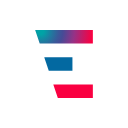 | **Symbol**<br>Das „E“ auf einer weißen Kachel. | [SVG](https://github.com/a-sit/a-sit-ci/raw/main/egiz/symbol/egiz-symbol.svg)<br>PNG (px): [64](https://github.com/a-sit/a-sit-ci/raw/main/egiz/symbol/egiz-symbol-64.png) · [128](https://github.com/a-sit/a-sit-ci/raw/main/egiz/symbol/egiz-symbol-128.png) · [256](https://github.com/a-sit/a-sit-ci/raw/main/egiz/symbol/egiz-symbol-256.png) · [512](https://github.com/a-sit/a-sit-ci/raw/main/egiz/symbol/egiz-symbol-512.png) |

Für das EGIZ-Logo gelten dieselben Regeln wie für das A-SIT-Logo. Der Freiraum rund um das Logo ist mindestens so breit wie ein Balken des „E“.

## Regeln für den Einsatz

- Das Logo nicht verzerren, drehen, umfärben oder mit Effekten versehen.
- Schrift und Flagge immer gemeinsam verwenden. Die Abstände nicht ändern.
- Rund um das Logo frei lassen: mindestens die Höhe der Flagge.
- Mindestgröße: 16 px Höhe am Bildschirm. [Platzhalter: Mindestgröße im Druck festlegen]
- Auf hellen Flächen die Standardfassung verwenden, auf dunklen Flächen die dunkle oder die negative Fassung.
- Auf unruhigen Fotos die einfarbige Fassung verwenden.

## Farben

| Name | Wert | Einsatz | Kontrast |
|---|---|---|---|
| A-SIT-Blau | `#0369A1` | Wortmarke auf hellen Flächen | 5,9 : 1 auf Weiß |
| A-SIT-Blau hell | `#6CBDF0` | Wortmarke auf dunklen Flächen | 9,2 : 1 auf `#0B111B` |
| Flagge 1 | `#00A3A6` | Verlauf, Stopp bei 4,6 % | |
| Flagge 2 | `#1C7FA0` | Verlauf, Stopp bei 14,9 % | |
| Flagge 3 | `#3A5999` | Verlauf, Stopp bei 27,5 % | |
| Flagge 4 | `#464B96` | Verlauf, Stopp bei 34,2 % | |
| Flagge 5 | `#963286` | Verlauf, Stopp bei 52,2 % | |
| Flagge 6 | `#FA0041` | Verlauf, Stopp bei 80 % | |

Der Verlauf ist radial. Sein Mittelpunkt liegt links oben an der Flagge. Die genaue Lage steht in `werkzeuge/logo-erzeugen.py`.

## Das Logo

Die Wortmarke „A=SIT“ ist in Bricolage Grotesque (ExtraBold) gesetzt und in Pfade umgewandelt. Zwischen A und SIT steht eine Flagge aus zwei Balken. Sie ist an das Logo von Digital Austria angelehnt:

- Die Balken sind so dick wie ein Bindestrich der Schrift.
- Die Flagge sitzt mittig auf Höhe der Großbuchstaben.
- Die linken Kanten beider Balken liegen in einer Flucht. Die Schräge läuft parallel zur rechten Kante des A (Steigung 1 : 3).
- Die Lücke zum A, die Lücke zum S und der Streifen zwischen den Balken sind je so breit wie ein Balken.
- Seitenverhältnis und Farbverlauf der Flagge stammen aus dem Logo von Digital Austria.

## Das EGIZ-Logo

Das „E“ besteht aus drei Balken. Danach folgt „GIZ“ in Bricolage Grotesque (ExtraBold), als Pfade.

- Die Balken sind so dick wie die Arme des E in der Schrift: ein Fünftel der Höhe der Großbuchstaben.
- Der obere und der untere Balken tragen den Verlauf der Flagge. Wie beim A-SIT-Logo gibt es genau zwei farbige Balken.
- Der mittlere Balken ist kürzer und hat die Farbe der Schrift.
- Die linken Kanten liegen in einer Flucht. Die Schräge hat dieselbe Steigung wie die Flagge im A-SIT-Logo (1 : 3).
- In den einfarbigen Fassungen haben alle drei Balken die Farbe der Schrift.

## Dateien im Repository

| Ordner | Inhalt |
|---|---|
| `logo/svg/` | Alle Fassungen als SVG. |
| `logo/png/` | Alle Fassungen als PNG, 64, 128, 256 und 512 px hoch. |
| `logo/vorschau/` | Vorschaubilder für diese Seite. |
| `logo/symbol/` | Symbol als SVG und PNG. In `web/` liegen `favicon.svg`, `favicon.ico` und `apple-touch-icon.png` für die Website. |
| `logo/teilen/og-standard.png` | Vorschaubild für geteilte Links (1200 × 630). Die Website nutzt es für Seiten ohne eigenes Titelbild. |
| `logo/entwuerfe/` | Nicht freigegebene Entwürfe mit kleinerer Flagge (85 % und 75 %). Nicht verwenden. |
| `egiz/` | EGIZ-Logo: `svg/`, `png/`, `vorschau/` und `symbol/`, aufgebaut wie `logo/`. |
| `farben/` | Farben als CSS-Variablen (`farben.css`) und als JSON (`farben.json`). |
| `hugo/` | Logo für den Header der Website technology.a-sit.at. |
| `werkzeuge/` | Generator für alle Logo-Dateien. |

## Für Entwickler: Logo neu erzeugen

Alle Dateien entstehen aus dem Generator. Nicht von Hand ändern.

Einmalig:

```bash
python3 -m venv .venv && .venv/bin/pip install fonttools
npm ci && npx playwright install chromium
```

Die Schrift Bricolage Grotesque (variable TTF) gibt es bei [Google Fonts](https://github.com/google/fonts/tree/main/ofl/bricolagegrotesque).

```bash
.venv/bin/python werkzeuge/logo-erzeugen.py <BricolageGrotesque[opsz,wdth,wght].ttf>
.venv/bin/python werkzeuge/egiz-logo-erzeugen.py <BricolageGrotesque[opsz,wdth,wght].ttf>
node werkzeuge/png-export.mjs
node werkzeuge/symbol-erzeugen.mjs
```

Entwurf mit anderer Flaggengröße (z. B. 85 %):

```bash
.venv/bin/python werkzeuge/logo-erzeugen.py <schrift.ttf> 0.85 logo/entwuerfe/a-sit-logo-flagge-85.svg
```

## Einbindung in die Website

`hugo.toml` macht dieses Repository zu einem Hugo-Theme-Baustein. Die Website bindet es als Submodul unter `themes/a-sit-ci` ein und stellt es vor das Basis-Theme: `theme = ["a-sit-ci", "asit-base"]`.

Die Website bindet dieses Repository als Git-Submodul ein. Ein neuer Stand hier erreicht sie über einen Pull Request von Dependabot. Dort wird er geprüft und freigegeben.

## Rechte und Fragen

Das Logo ist Eigentum von A-SIT. [Platzhalter: Bedingungen für die Verwendung durch Dritte, z. B. Partner und Presse]

Fragen zum Logo: [Platzhalter: Kontakt]

Die Schrift Bricolage Grotesque steht unter der SIL Open Font License 1.1 (`lizenzen/OFL-BricolageGrotesque.txt`). Sie wird nur zum Erzeugen der Dateien gebraucht. Im Logo ist sie in Pfade umgewandelt.
